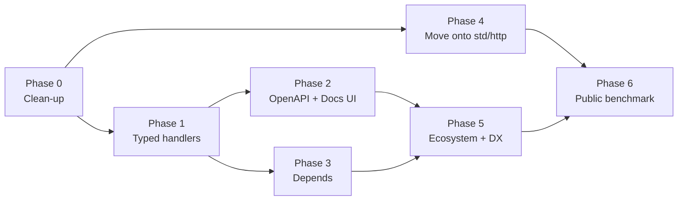

# iyi-web roadmap

Written: 2026-11-04, iyi-web 0.5.1, iyi 0.20.1.
Goal: go head to head with FastAPI, be better than Express, and keep
Kemal's simplicity (without being quite that bare).

## The short verdict

It does everything Kemal does, and beats it in a few places. It lacks the
two things that make FastAPI FastAPI: **typed handlers** and **automatic
OpenAPI documentation**. What stands between it and Express is not code but
ecosystem.

The state at the time of the review:

- `iyi test iyi_web`: 42 of 42 files passed (134 s).
- `iyi_web/`: 18,340 lines, about half of them tests.
- The benchmarks were not re-run (`bench/cores.sh` runs on Linux only and
  needs `wrk`); the numbers below come from the old `bench/results.json`.

## What it has (strengths)

| Area | State |
|---|---|
| Routing | Radix tree, `:id` and `*path`, automatic 404/405, an error at startup for a route defined twice, tolerance of a trailing `/` |
| Type safety | The type a route returns is checked at compile time (`IntoBody`); Kemal has nothing like it |
| Every core | Every core is used through `spawn_parallel`; writing a data race is a compile error, and the message shows both ways out. Neither Express nor FastAPI has this: the strongest card |
| JSON | `json_as(T)` + `Validate`: 400/415/422 answers and field paths like `tags[1]`; the closest piece to FastAPI/Pydantic |
| Security | Header injection blocked, CSRF, encrypted cookie sessions, rate limiting, basic auth, security headers, the `%5C` path traversal fix on Windows |
| Protocols | WebSocket, SSE, streaming, TLS, IPv6, unix sockets, graceful shutdown, timeouts |
| Static files | ETag, 304, Range/206, gzip, precompressed `.gz` |
| Testing | `harness` tests without a socket; a benchmark regression gate in CI |

## What is missing or weak

1. **Parameters are always strings.** You have to write
   `env.params.url["id"].to_i? || 0`, and `[]` panics when the key is
   missing. In FastAPI `id: int` is enough.
2. **No OpenAPI or Swagger UI.** FastAPI's biggest selling point.
3. **No dependency injection.** There is no reusable shape for work like
   "find the user before this route, hand it a DB connection"; `env.set/get`
   is only a primitive start.
4. **Templates don't escape automatically** (the README's "Templates"
   section says so plainly). Forget `HTML.escape` once and you have an XSS
   hole.
5. **You wrote your own HTTP server, but std has moved past it.**
   `server.iyi` + `intake.iyi` + `websocket.iyi` are about 1,900 lines. The
   installed `std/http` already does the following (the comment at the top
   of std/http.iyi):
   - HTTP/2 (h2c and ALPN),
   - `stream_bodies: true`,
   - zstd,
   - TLS 1.2 and mTLS,
   - Let's Encrypt through `std/autocert`.

   iyi-web uses none of it.
6. **Parsing an incoming request is expensive.** In the old measurement
   `intake.get` took ~5 µs per request, radix lookup ~0.28 µs. The head is
   scanned once for framing, copied into a string, and then `std/http`
   parses the same head again from the start. The body is held whole in
   memory; a 64 MB request grows to several times that.
7. **The performance numbers are old and there is no comparison.**
   `results.json` was taken with iyi 0.18, on one thread, on Windows: 27.6k
   req/s for hello, p99 ~3 ms. Nothing measured side by side with FastAPI,
   Express or Kemal.
8. **Shared state is tedious to write.** It takes `Mutex.new { }`,
   `.get { }.or_panic`, and `List.new(...)` to leave the lock. Even
   `examples/typed_json.iyi` escapes to `workers: 1` because of it.
9. **Missing features:** startup/shutdown hooks, JWT/OAuth2/API key,
   background tasks, metrics/tracing, `reuse_port` (still not in
   std/socket), a command that scaffolds a project, hot reload. (The
   database side is ready: `iyilang/db`, `iyilang/pg`, `iyilang/mysql`; no
   new driver will be written in iyi-web.)
10. **Some of the docs are stale.** The README says "TLS 1.3 only", but
    std/tls speaks 1.2 too now. `iyi-web-vs-kemal.md` says "33 test files";
    there are 42. The README shows `@v0.5.0`; the latest release is 0.5.1.
    All the documentation is one 1,600-line README. *(The version and the
    Kemal comparison's status are fixed in Phase 0.)*

## Side by side with the competition

| | FastAPI | Express | Kemal | iyi-web (at review) | iyi-web (after the roadmap) |
|---|---|---|---|---|---|
| Hello in 3 lines | ✅ | ✅ | ✅ | ✅ | ✅ |
| Typed parameters | ✅ | ❌ | ❌ | ⚠️ JSON body only | ✅ `path:`/`query:`/`headers:`/`body:` |
| Validation | ✅ Pydantic | ❌ (via a package) | ❌ | ✅ | ✅ |
| OpenAPI + UI | ✅ | ❌ (via a package) | ❌ | ❌ | ✅ at compile time, `/docs` |
| DI | ✅ `Depends` | ❌ | ❌ | ❌ | ✅ `deps:` + `Dep` |
| Every core | ⚠️ worker processes | ⚠️ cluster | ✅ | ✅ + compile-time race checks | ✅ + `Store(T)` |
| HTTP/2 | ⚠️ depends on the server | ⚠️ | ❌ | ❌ (in std) | ✅ h2c + ALPN h2 |
| WebSocket/SSE | ✅ | ⚠️ via a package | ✅ | ✅ | ✅ |
| Built-in session/CSRF | ❌ | ❌ | ⚠️ a separate shard | ✅ | ✅ |
| Ecosystem | 🟢 huge | 🟢 huge | 🟡 | 🔴 | 🟡 CLI, DB example, metrics/tracing; the community is still small |

## ELI5 roadmap

The analogy: iyi-web is a **restaurant kitchen**. The kitchen is solid,
there are plenty of burners, there is even a fire alarm. What is missing is
the **menu** (OpenAPI), **the waiter writing the order down right** (typed
parameters) and **customers finding the door** (ecosystem and docs).



### Phase 0: Tidy the kitchen (small, quick)

**ELI5:** The knives are lying around, and the sign on the door shows the
wrong opening hours.

- [x] Templates escape by default, with an explicit way out such as `raw`
      for raw output. A breaking change: announce it in the CHANGELOG.
- [ ] Fix the TLS and version facts in the README, update
      `iyi-web-vs-kemal.md`.
- [x] Small helpers like `env.params.url.int("id")` answering
      `Int32 | ParamError`.
- [x] `on_start` / `on_stop` hooks (FastAPI's `lifespan`).

**Done when:** forgetting to escape no longer produces XSS; every claim in
the docs matches what the code does.

**Status:** autoescape (`raw`, `SafeHTML`), `env.params.int(...)` and
friends, and `on_start`/`on_stop` are in. The README's `@v0.5.0` examples
and the status section of `iyi-web-vs-kemal.md` are updated; the TLS/HTTP
version claims will be fixed with Phase 4's transport work.

### Phase 1: The waiter writes the order down right (the part that actually beats FastAPI)

**ELI5:** The customer says "2 teas", the waiter writes "two teas", and the
kitchen then has to guess whether that is a number. Instead, the order slip
gets boxes to fill in.

Draft API (the syntax is not final; an inference that iyi's macros could
build it this way):

```iyi
struct NoteQuery
  getter page : Int32 = 1
  getter q : String? = nil
  derive params            # read from query/path/headers, 422 on error
end

get "/notes/:id", path: NoteId, query: NoteQuery do |env, id, q|
  ...
end

post "/notes", body: NoteInput do |env, input|   # the framework answers the BodyError itself
  env.status(201).json(save(input))
end
```

- [x] `json_as` and `Validate` already exist; this phase means moving them
      into the route's signature.
- [x] The response type can be declared too (FastAPI's `response_model`);
      Phase 2 needs it.
- **Simplicity rule:** `get "/" do |env|` keeps working exactly as it does.
  The typed form is an optional layer on top.

**Done when:** no hand-written `to_i?` or `case ... in BodyError` is left in
`examples/typed_json.iyi` and `examples/json_api.iyi`.

**Status:** done. `path:`, `query:`, `headers:`, `body:`, `response:` and
`status:` on every route method; neither example has a hand-written
`to_i?` or a `BodyError` match left (see `docs/typed-routes.md`).

### Phase 2: The menu (OpenAPI 3.1 + Swagger UI/Scalar)

**ELI5:** The customer sees what they can order from the menu without
walking into the kitchen.

- [x] Route registrations + Phase 1's types → `/openapi.json`.
- [x] An embedded UI at `/docs` (one static HTML page is enough).
- The document is generated at compile time; a card against FastAPI, which
  builds its schema at run time.

**Done when:** `/openapi.json` passes an OpenAPI validator and a client
generated from it (e.g. openapi-generator) can call the real API.

**Status:** done. `openapi(...)` serves `/openapi.json` and `/docs` with
Swagger UI; the document of `examples/json_api.iyi` passes
openapi-spec-validator (see `docs/openapi.md`).

### Phase 3: Kitchen helpers (the `Depends` equivalent)

**ELI5:** "Wash your hands, warm the plate" should not be written out again
before every dish. Define it once, attach it to whichever dish you like.

- [ ] A function like `def current_user(env) : User | HttpError` is attached
      to a route with `deps: {user: current_user}` and reaches the block
      typed.
- [ ] Ready-made pieces: Bearer/JWT, API key, OAuth2 password flow (iyi std
      has pieces such as `password` and `otp`).
- [ ] They show up in OpenAPI as `securitySchemes`.

### Phase 4: Move the kitchen into the new building (onto std/http)

**ELI5:** The city built a new and better kitchen: an HTTP/2 stove, running
water (streams), an automatic certificate doorman. You are still doing
everything by hand in the old building.

- [ ] Hand the transport layer to `std/http`'s `Server.serve`. Router,
      Context and middleware stay as they are.
- What comes for free: HTTP/2, `stream_bodies` (a large upload does not
  swell memory), zstd, mTLS, `std/autocert`. The head is no longer parsed
  twice either.
- **Risk:** iyi-web's own guarantees may not be exactly the same in std:
  the 414/431 bounds, `read/write/idle_timeout`, shutdown drain, unix
  sockets. Tests covering them must pass on std first; what does not should
  go to std as a PR or be covered by a thin adapter.
- [ ] A PR to std/socket for `reuse_port`.

**Done when:** the 42 test files pass on the new transport and
`curl --http2` works.

### Phase 5: Ecosystem and developer experience (to beat Express)

**ELI5:** Even the best kitchen stays empty if nobody knows the way.

- [ ] **Database:** no new driver; use the existing
      [iyilang/db](https://github.com/iyilang/db),
      [iyilang/pg](https://github.com/iyilang/pg) and
      [iyilang/mysql](https://github.com/iyilang/mysql).
      The work on iyi-web's side: an example application on them, a
      README/docs section, and the pattern for handing a route a connection
      through Phase 3's `deps:`.
- [ ] Project scaffolding with `iyi-web new myapp`, hot reload with
      `iyi-web dev`.
- [ ] A docs site: tutorial + reference (modelled on FastAPI's docs); the
      1,600-line README is split up.
- [ ] Shared-state ergonomics: a small `Store(T)` helper that hides the
      `Mutex` + `List` dance, so examples don't have to escape to
      `workers: 1`.
- [ ] `/metrics` (Prometheus), OpenTelemetry trace middleware, background
      tasks.
- [ ] A plugin guide on how to write community middleware.

### Phase 6: Enter the race (a public benchmark)

**ELI5:** Saying "we're the fastest" isn't enough; you have to run on the
same track and show the stopwatch.

- [ ] The same 3 endpoints (hello, JSON, DB query) on the same machine for
      iyi-web, FastAPI (uvicorn workers), Express, Kemal and Go net/http;
      the results and scripts live in the repo.
- [ ] The hot spot to target, `intake.get` (~5 µs); to be measured again
      after Phase 4.
- [ ] A TechEmpower submission.

## The simplicity line (how far to move from Kemal)

- **Layer 1 (Kemal's simplicity):** `get "/" do |env| "hi" end`. Must never
  break.
- **Layer 2 (FastAPI's power):** typed routes with `body:` / `query:` /
  `deps:`. Optional.
- **Layer 3 (not Rails):** an ORM, an admin panel or an asset pipeline do
  not go into the core; they stay separate modules.

Keep these three layers and the balance of "as simple as Kemal, but not
quite that bare" holds by itself.

## Suggested starting point

The quickest win is Phase 0 (template autoescape + bringing the docs up to
date). Or go straight to Phase 1's API design: a prototype of the
`body:` / `query:` signature.
