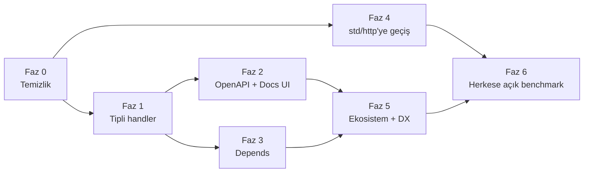

# iyi-web roadmap

Hazırlandı: 2026-11-04, iyi-web 0.5.1, iyi 0.20.1.
Hedef: FastAPI ile kapışmak, Express'ten iyi olmak, Kemal'in sadeliğini
korumak (ama o kadar da sade olmamak).

## Kısa hüküm

Kemal'in yaptığı her şeyi yapıyor, birkaç yerde onu geçiyor. FastAPI'yi
FastAPI yapan iki şey eksik: **tipli handler** ve **otomatik OpenAPI
dokümanı**. Express'in önündeki asıl engel kod değil, ekosistem.

İnceleme sırasındaki durum:

- `iyi test iyi_web`: 42 dosyanın 42'si geçti (134 sn).
- `iyi_web/`: 18.340 satır, yaklaşık yarısı test.
- Benchmark yeniden çalıştırılmadı (`bench/cores.sh` yalnızca Linux'ta
  çalışıyor ve `wrk` istiyor); aşağıdaki sayılar eski `bench/results.json`
  dosyasından.

## Ne var (güçlü taraflar)

| Alan | Durum |
|---|---|
| Routing | Radix ağacı, `:id` ve `*path`, otomatik 404/405, aynı route iki kez yazılırsa açılışta hata, trailing `/` toleransı |
| Tip güvenliği | Route'un döndürdüğü tip derlenirken kontrol ediliyor (`IntoBody`); Kemal'de böyle bir şey yok |
| Çok çekirdek | `spawn_parallel` ile her çekirdek kullanılıyor; data race yazmak derleme hatası ve hata mesajı iki çıkış yolu gösteriyor. Express'te de FastAPI'de de yok: en güçlü koz |
| JSON | `json_as(T)` + `Validate`: 400/415/422 cevapları ve `tags[1]` gibi alan yolları; FastAPI/Pydantic'e en yakın parça |
| Güvenlik | Header injection engeli, CSRF, şifreli cookie session, rate limit, basic auth, security headers, Windows'ta `%5C` path traversal düzeltmesi |
| Protokoller | WebSocket, SSE, streaming, TLS, IPv6, unix socket, graceful shutdown, timeout'lar |
| Statik dosya | ETag, 304, Range/206, gzip, önceden sıkıştırılmış `.gz` |
| Test | `harness` ile soket açmadan test; CI'da benchmark regresyon kapısı |

## Ne yok, ne zayıf

1. **Parametreler hep string.** `env.params.url["id"].to_i? || 0` yazmak
   gerekiyor; `[]` anahtar yoksa panic atıyor. FastAPI'de `id: int` yetiyor.
2. **OpenAPI ve Swagger UI yok.** FastAPI'nin en büyük satış noktası.
3. **Dependency injection yok.** "Bu route'tan önce kullanıcıyı bul, DB
   bağlantısını ver" gibi işler için tekrar kullanılabilir bir yapı yok;
   `env.set/get` sadece ilkel bir başlangıç.
4. **Template'ler otomatik escape etmiyor** (README "Templates" bölümü
   bunu açıkça söylüyor). Bir yerde `HTML.escape` unutulursa XSS açığı
   oluşuyor.
5. **Kendi HTTP sunucunu yazıyorsun, ama std artık bunun ötesine geçti.**
   `server.iyi` + `intake.iyi` + `websocket.iyi` yaklaşık 1.900 satır.
   Kurulu `std/http` şunları zaten yapıyor (std/http.iyi başındaki yorum):
   - HTTP/2 (h2c ve ALPN),
   - `stream_bodies: true`,
   - zstd,
   - TLS 1.2 ve mTLS,
   - `std/autocert` ile Let's Encrypt.

   iyi-web bunların hiçbirini kullanmıyor.
6. **Gelen istek ayrıştırması pahalı.** Eski ölçümde `intake.get` istek
   başına ~5 µs, radix lookup ~0,28 µs. Başlık önce framing için taranıyor,
   string'e kopyalanıyor, sonra `std/http` aynı başlığı baştan bir daha
   ayrıştırıyor. Body bütünüyle bellekte tutuluyor; 64 MB'lık istek bellekte
   bunun birkaç katına çıkıyor.
7. **Performans sayıları eski ve kıyas yok.** `results.json` iyi 0.18 ile,
   tek thread'de, Windows'ta alınmış: hello için 27,6k req/s, p99 ~3 ms.
   FastAPI, Express veya Kemal ile yan yana ölçüm yok.
8. **Paylaşılan state yazmak zahmetli.** `Mutex.new { }`, `.get { }.or_panic`,
   kilitten çıkarken `List.new(...)` gerekiyor. `examples/typed_json.iyi`
   bile bu yüzden `workers: 1`'e kaçıyor.
9. **Eksik özellikler:** startup/shutdown hook'ları, JWT/OAuth2/API key,
   background task, metrics/tracing, `reuse_port` (std/socket'te hâlâ yok),
   proje iskeleti üreten komut, hot reload. (Veritabanı tarafı hazır:
   `iyilang/db`, `iyilang/pg`, `iyilang/mysql`; iyi-web'de yeni sürücü
   yazılmayacak.)
10. **Dokümanların bir kısmı eskimiş.** README "TLS 1.3 only" diyor ama
    std/tls artık 1.2'yi de konuşuyor. `iyi-web-vs-kemal.md` "33 test
    dosyası" diyor, şu an 42. README `@v0.5.0` örneği veriyor, son sürüm
    0.5.1. Bütün doküman tek bir 1.600 satırlık README.

## Rakiplerle yan yana

| | FastAPI | Express | Kemal | iyi-web bugün |
|---|---|---|---|---|
| 3 satırda hello | ✅ | ✅ | ✅ | ✅ |
| Tipli parametre | ✅ | ❌ | ❌ | ⚠️ sadece JSON body |
| Validasyon | ✅ Pydantic | ❌ (paketle) | ❌ | ✅ |
| OpenAPI + UI | ✅ | ❌ (paketle) | ❌ | ❌ |
| DI | ✅ `Depends` | ❌ | ❌ | ❌ |
| Çok çekirdek | ⚠️ worker process'leri | ⚠️ cluster | ✅ | ✅ + derleme anında race kontrolü |
| HTTP/2 | ⚠️ sunucuya bağlı | ⚠️ | ❌ | ❌ (std'de var) |
| WebSocket/SSE | ✅ | ⚠️ paketle | ✅ | ✅ |
| Session/CSRF dahili | ❌ | ❌ | ⚠️ ayrı shard | ✅ |
| Ekosistem | 🟢 dev | 🟢 dev | 🟡 | 🔴 |

## ELI5 roadmap

Benzetme: iyi-web bir **lokanta mutfağı**. Mutfak sağlam, ocaklar çok,
yangın alarmı bile var. Eksik olanlar **menü** (OpenAPI), **garsonun
siparişi doğru yazması** (tipli parametre) ve **müşterinin kapıyı bulması**
(ekosistem ve doküman).



### Faz 0: Mutfağı topla (küçük, hızlı)

**ELI5:** Bıçaklar açıkta duruyor, tabelada yanlış saat yazıyor.

- [ ] Template'lerde otomatik escape varsayılan olsun, ham çıktı için `raw`
      gibi açık bir kaçış olsun. Breaking change: CHANGELOG'da duyurulmalı.
- [ ] README'deki TLS ve sürüm bilgisini düzelt, `iyi-web-vs-kemal.md`'yi
      güncelle.
- [ ] `env.params.url.int("id")` gibi `Int32 | ParamError` döndüren küçük
      yardımcılar.
- [ ] `on_start` / `on_stop` hook'ları (FastAPI'deki `lifespan`).

**Bitti sayılır:** escape unutulduğunda XSS çıkmıyor; dokümandaki her iddia
koddaki davranışla uyuşuyor.

### Faz 1: Garson siparişi doğru yazsın (FastAPI'yi asıl yenecek kısım)

**ELI5:** Müşteri "2 çay" diyor, garson "iki çay" diye not alıyor, sonra
mutfak bunun sayı olup olmadığını tahmin etmeye çalışıyor. Bunun yerine
sipariş fişinde kutucuklar olsun.

Taslak API (sözdizimi kesin değil; iyi'nin macro'larıyla bu şekilde
kurulabileceği bir çıkarım):

```iyi
struct NoteQuery
  getter page : Int32 = 1
  getter q : String? = nil
  derive params            # query/path/header'dan okunur, hatada 422
end

get "/notes/:id", path: NoteId, query: NoteQuery do |env, id, q|
  ...
end

post "/notes", body: NoteInput do |env, input|   # BodyError'ı framework kendisi döndürür
  env.status(201).json(save(input))
end
```

- [ ] `json_as` ve `Validate` zaten var; bu faz onları route imzasına
      taşımak demek.
- [ ] Response tipi de bildirilebilmeli (FastAPI'deki `response_model`);
      Faz 2 için gerekiyor.
- **Sadelik kuralı:** `get "/" do |env|` aynen çalışmaya devam eder. Tipli
  biçim isteğe bağlı bir üst katman olur.

**Bitti sayılır:** `examples/typed_json.iyi` ve `examples/json_api.iyi`
içinde elle yazılmış hiçbir `to_i?` veya `case ... in BodyError` kalmıyor.

### Faz 2: Menü (OpenAPI 3.1 + Swagger UI/Scalar)

**ELI5:** Müşteri mutfağa girmeden menüden ne sipariş edebileceğini görsün.

- [ ] Route kayıtları + Faz 1'in tipleri → `/openapi.json`.
- [ ] `/docs` adresinde gömülü bir UI (tek bir statik HTML yeterli).
- Doküman derleme anında üretilir; FastAPI'ye karşı koz, orada şema
  çalışma anında üretiliyor.

**Bitti sayılır:** `/openapi.json` bir OpenAPI validator'ından geçiyor ve
oradan üretilen bir client (ör. openapi-generator) gerçek API'yi
çağırabiliyor.

### Faz 3: Yardımcı aşçılar (`Depends` karşılığı)

**ELI5:** Her yemekten önce "elleri yıka, tabağı ısıt" adımı tekrar tekrar
yazılmasın. Bir kere tanımla, istediğin yemeğe bağla.

- [ ] `def current_user(env) : User | HttpError` gibi bir fonksiyon
      `deps: {user: current_user}` ile route'a bağlanır, block'a tipli gelir.
- [ ] Hazır parçalar: Bearer/JWT, API key, OAuth2 password flow (iyi std'de
      `password`, `otp` gibi parçalar mevcut).
- [ ] Bunlar OpenAPI'ye `securitySchemes` olarak yansır.

### Faz 4: Mutfağı yeni binaya taşı (std/http'nin üstüne geç)

**ELI5:** Belediye yeni ve daha iyi bir mutfak yapmış: HTTP/2 ocağı, akan su
(stream), otomatik sertifika kapıcısı. Sen eski binada her şeyi kendi
elinle yapıyorsun.

- [ ] Transport katmanını `std/http`'nin `Server.serve` fonksiyonuna devret.
      Router, Context ve middleware olduğu gibi kalır.
- Bedavaya gelenler: HTTP/2, `stream_bodies` (büyük upload belleği
  şişirmez), zstd, mTLS, `std/autocert`. Başlığın iki kez ayrıştırılması da
  ortadan kalkar.
- **Risk:** iyi-web'in kendi garantileri std'de birebir aynı olmayabilir:
  414/431 sınırları, `read/write/idle_timeout`, shutdown drain, unix socket.
  Önce bunları kapsayan testler std üzerinde de geçmeli; geçmeyenler std'ye
  PR olarak gitmeli ya da ince bir adapter ile kapatılmalı.
- [ ] `reuse_port` için std/socket'e PR.

**Bitti sayılır:** 42 test dosyası yeni transport üzerinde geçiyor ve
`curl --http2` çalışıyor.

### Faz 5: Ekosistem ve geliştirici deneyimi (Express'i geçmek için)

**ELI5:** En iyi mutfak bile kimse yolu bilmezse boş kalır.

- [ ] **Veritabanı:** yeni sürücü yazılmayacak; mevcut
      [iyilang/db](https://github.com/iyilang/db),
      [iyilang/pg](https://github.com/iyilang/pg) ve
      [iyilang/mysql](https://github.com/iyilang/mysql) kullanılacak.
      iyi-web tarafındaki iş: bunlarla bir örnek uygulama, README/doküman
      bölümü ve Faz 3'teki `deps:` ile route'a bağlantı vermenin kalıbı.
- [ ] `iyi-web new myapp` ile proje iskeleti, `iyi-web dev` ile hot reload.
- [ ] Doküman sitesi: tutorial + referans (FastAPI'nin dokümanı model);
      1.600 satırlık README bölünür.
- [ ] Paylaşılan state ergonomisi: `Mutex` + `List` dansını saklayan küçük
      bir `Store(T)` yardımcısı; örnekler `workers: 1`'e kaçmak zorunda
      kalmaz.
- [ ] `/metrics` (Prometheus), OpenTelemetry trace middleware'i, background
      task'lar.
- [ ] Topluluk middleware'lerinin nasıl yazılacağını anlatan plugin rehberi.

### Faz 6: Yarışa çık (herkese açık benchmark)

**ELI5:** "En hızlıyız" demek yetmez; aynı pistte koşup kronometreyi
göstermek lazım.

- [ ] Aynı makinede, aynı 3 endpoint (hello, JSON, DB query) için iyi-web,
      FastAPI (uvicorn workers), Express, Kemal ve Go net/http; sonuçlar ve
      script'ler repoda.
- [ ] Hedef sıcak nokta `intake.get` (~5 µs); Faz 4 sonrasında yeniden
      ölçülmeli.
- [ ] TechEmpower'a başvuru.

## Sadelik çizgisi (Kemal'den ne kadar uzaklaşmalı)

- **Katman 1 (Kemal sadeliği):** `get "/" do |env| "hi" end`. Asla
  bozulmamalı.
- **Katman 2 (FastAPI gücü):** `body:` / `query:` / `deps:` ile tipli
  route'lar. İsteğe bağlı.
- **Katman 3 (Rails değil):** ORM, admin paneli, asset pipeline core'a
  girmesin; ayrı modül olarak dursun.

Bu üç katman korunursa "Kemal kadar sade ama o kadar da değil" dengesi
kendiliğinden kurulur.

## Önerilen başlangıç

En hızlı kazanç Faz 0 (template autoescape + doküman güncellemesi). Ya da
doğrudan Faz 1'in API tasarımı: `body:` / `query:` imzası için bir prototip.
